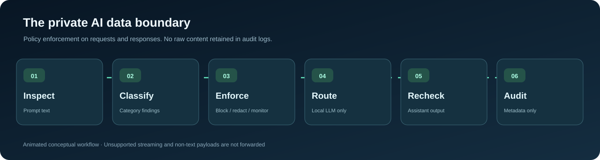
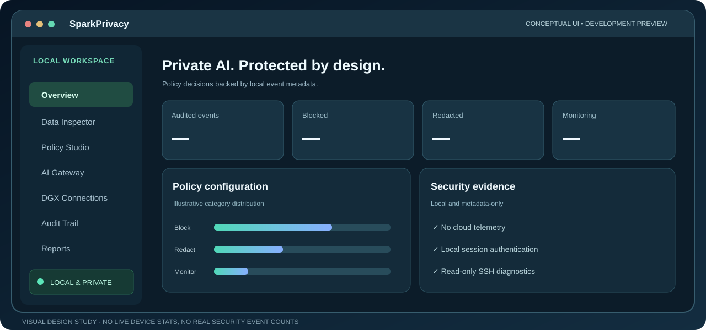
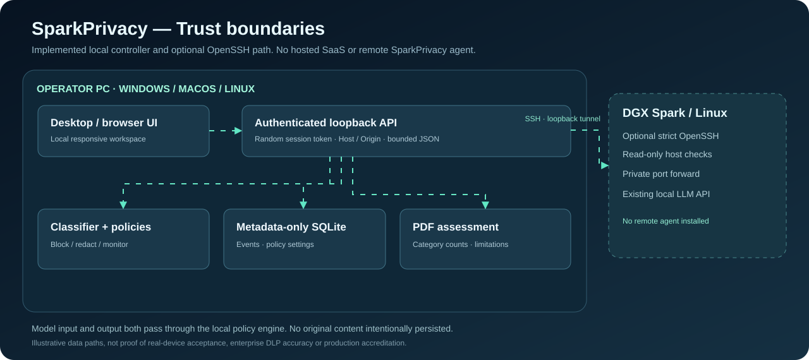
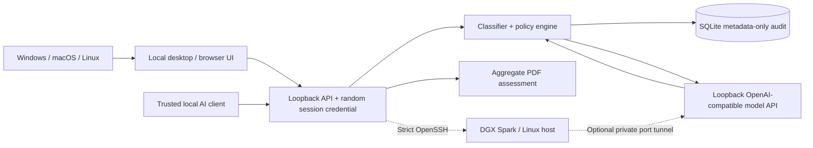

<div align="center">



# SparkPrivacy

### Private AI. Protected by design.

**A local-first data-protection workbench for NVIDIA DGX Spark and other private AI deployments.**

Detect sensitive information. Apply clear block/redact/monitor policies. Route text chat requests through a secure local gateway. Generate metadata-only assessment reports.

**Windows · macOS · Linux** &nbsp; | &nbsp; **Local-first** &nbsp; | &nbsp; **No SaaS account** &nbsp; | &nbsp; **Independent project**

[**Download preview installers**](https://github.com/hossain0707/SparkPrivacy/releases) · [Animated walkthrough](#how-it-works) · [Architecture](#system-architecture) · [Security model](docs/SECURITY.md) · [Continue development](START_HERE.md)

[](https://github.com/hossain0707/SparkPrivacy/actions/workflows/ci.yml)


</div>

> [!IMPORTANT]
> **Development preview, not production-certified DLP.** SparkPrivacy implements useful real controls, but regex/pattern-based detection cannot identify every secret or sensitive document. Do not interpret reports as regulatory compliance evidence or a guarantee that information cannot leak. Full real-DGX hardware validation, installer acceptance, external penetration testing, and code signing remain release gates. SparkPrivacy is **not** an NVIDIA product or endorsed by NVIDIA.

---

## Download and install

The GitHub Actions release workflow is configured to publish unsigned preview installers **after all platform checks succeed**. Download only a [release that actually appears on GitHub](https://github.com/hossain0707/SparkPrivacy/releases). If no release is listed, the cross-platform packages have not yet been verified/published; use the source installation below.

| Your computer | Expected GitHub Release asset | Installation |
| --- | --- | --- |
| **Windows 10/11 — 64-bit** | `SparkPrivacy-Setup-Windows-x64.exe` | Run per-user setup, then open SparkPrivacy from Start Menu |
| **macOS — Apple Silicon** | `SparkPrivacy-macOS-Apple-Silicon-unsigned.dmg` | Open the disk image, drag the app into Applications |
| **macOS — Intel** | `SparkPrivacy-macOS-Intel-unsigned.dmg` | Open the disk image, drag the app into Applications |
| **Ubuntu 24.04 — 64-bit** | `SparkPrivacy-Linux-Ubuntu-x64.deb` | Install through Software or `sudo apt install ./<file>.deb` |
| **Portable** | Windows ZIP / Linux TAR.GZ | Extract the complete folder and launch its executable |

Every published preview must include `SHA256SUMS.txt`. **The preview applications are unsigned**; follow your organization's application-trust policies, rather than disabling device protection to run an unfamiliar binary. More information: [Installation guide](docs/INSTALL.md) and [release checklist](docs/RELEASE.md).

## Why SparkPrivacy?

AI applications can receive employee records, authentication credentials, customer contact details, or confidential context through prompts and documents. Private inference reduces some external dependencies but **does not automatically enforce input and output data policies**.

SparkPrivacy adds a controllable local protection layer around **text-only OpenAI-compatible chat calls**. Its default policies block recognized tokens, payment card candidates and identity numbers, while redacting commonly recognized email addresses and phone numbers.

<table><tr><td width="33%"><b>DETECT</b><br/>Run bounded sensitive-information scanning locally with transparent category findings.</td><td width="34%"><b>ENFORCE</b><br/>Configure block, redact, or monitor actions on both requests and model responses.</td><td width="33%"><b>DOCUMENT</b><br/>Keep metadata-only audit history and export traceable, scope-limited PDF evidence.</td></tr></table>

## How it works

<p align="center"></p>

1. **Inspect:** paste sample content or submit a text chat request through the local API.
2. **Classify:** match supported categories such as email, phone, payment-card candidates, API-key formats, Korean resident numbers and formatted US SSNs.
3. **Enforce:** block a request or redact matching sensitive spans; monitoring is an explicitly risky, user-selected mode.
4. **Route:** if allowed, send a sanitized text payload to a configured **loopback-only** model endpoint. A DGX Spark can be reached through a private SSH tunnel.
5. **Reinspect and report:** evaluate returned assistant text; persist **category counts and decisions**, not raw content, and generate a PDF assessment.

*Animated diagram is illustrative. It does not represent a completed physical DGX Spark test, live customer deployment, or certified privacy guarantees.*

## Product experience

<p align="center"></p>

A responsive, dark-themed workspace with subtle motion, keyboard-accessible controls, clear empty states, and no remote trackers. The UI contains eight working areas:

| Module | In v0.1.0 | Limitation |
| --- | --- | --- |
| **Overview** | Actual local audit counts and recent events | Not cross-enterprise telemetry |
| **Data Inspector** | Local redaction preview and categorized findings | Pattern-based, false positives/negatives possible |
| **Policy Studio** | Persistent six-category block/redact/monitor rules | Not an enterprise identity/access policy system |
| **AI Gateway** | Authenticated text-only OpenAI-style API proxy with response filtering | Non-streaming; local endpoints only; no multimodal/tool calls |
| **DGX Connections** | SSH alias import, read-only diagnostics and loopback SSH tunneling | Existing credentials and verified SSH host keys required |
| **Audit Trail** | Local SQLite timestamps, channel, decision and category counts | Not a tamper-proof external audit store |
| **Reports** | Metadata-only PDF assessments | Not an official certification |
| **Settings** | Audit retention and local security indicators | No fleet-wide central administrator |

## System architecture

<p align="center"></p>

**Controller and policy engine run on the operator's Windows, macOS, or Linux computer.** The localhost-bound model gateway protects text chat completions. A model can run on the same computer, or on a DGX Spark with the model API exposed through an existing authenticated SSH tunnel. No public hosted backend or additional remote SparkPrivacy agent is necessary.

<details>
<summary><b>Editable Mermaid component diagram</b></summary>



</details>

See [Architecture](docs/ARCHITECTURE.md), [Threat model](docs/SECURITY.md) and [Design system](docs/DESIGN_SYSTEM.md).

## Quick start from source

Works on **Python 3.11+** and does not require DGX hardware for local scanning, policy configuration, audit storage, or PDF reporting. Downloading dependencies requires an internet connection once.

**Windows PowerShell**

```powershell
git clone https://github.com/hossain0707/SparkPrivacy.git
cd SparkPrivacy
py -3 -m venv .venv
.\.venv\Scripts\python.exe -m pip install -e .
.\.venv\Scripts\python.exe -m sparkprivacy
```

**macOS / Linux**

```bash
git clone https://github.com/hossain0707/SparkPrivacy.git
cd SparkPrivacy
python3 -m venv .venv
source .venv/bin/activate
python -m pip install -e .
python -m sparkprivacy
```

The app starts on a free **127.0.0.1** port and opens a local browser. Metadata audit is stored under `~/.sparkprivacy/audit.sqlite3`, with restricted directory permissions on Unix. Do not expose this local HTTP server through a reverse proxy, a public tunnel, or container port mapping.

### How to connect a DGX Spark

- Establish Ethernet, LAN, or an existing secure VPN connection.
- Confirm the SSH host fingerprint independently and configure system OpenSSH and your SSH key/agent. Existing VS Code-style `~/.ssh/config` aliases work.
- In **DGX Connections**, select the alias and run read-only diagnostics.
- If your Spark model server listens on `127.0.0.1:8000`, create a private tunnel to that remote port. The application will provide a local forwarded port; enter `http://127.0.0.1:<forwarded-port>/v1/chat/completions` in the gateway settings.

Remote SSH inspection is optional. If the host is down or unbootable, SSH access cannot work. See [Connection guide](docs/CONNECTIONS.md).

### Local API integration

Trusted local applications may call `POST http://127.0.0.1:<app-port>/v1/chat/completions` using a `Bearer` token shown by the **Copy session token** control in the Gateway view. The token is ephemeral and changes each time the application starts. Keep it secret. **Streaming, image/audio inputs, tool calls and unsupported schemas are deliberately rejected or reduced to supported text fields** until complete data handling is implemented and tested.

## Development verification

```bash
python -m pip install -e '.[dev]'
python -m pytest -q
node --check sparkprivacy/frontend/app.js
python desktop_launcher.py --self-test
```

Cross-platform CI runs Windows, macOS and Ubuntu Python tests, dependency audit, packaged desktop self-tests, and prerelease packaging. **Successful automated builds do not equal clean-machine acceptance or penetration testing.** See [VERIFICATION.md](docs/VERIFICATION.md) for the evidence ledger.

## Product status

| Release gate | Current status |
| --- | --- |
| Local DLP scanner, policies, gateway, reporting and UI | **Implemented** |
| Local automated security/functional test suite | **55 tests passing** in development environment |
| Packaged executable self-test | **Passing from source** |
| Signed Windows/macOS/Linux production packages | **Not completed** |
| Physical DGX Spark ethernet/SSH acceptance | **Not completed** |
| Independent security review, accuracy/recall evaluation and privacy compliance | **Not completed** |

## Project continuity

- **[START_HERE.md](START_HERE.md):** full implementation, architecture, test status, next milestones and handover prompt.
- **[AGENTS.md](AGENTS.md):** engineering guardrails and module map.
- [SECURITY.md](docs/SECURITY.md) · [ARCHITECTURE.md](docs/ARCHITECTURE.md) · [CONNECTIONS.md](docs/CONNECTIONS.md)
- [DESIGN_SYSTEM.md](docs/DESIGN_SYSTEM.md) · [RELEASE.md](docs/RELEASE.md) · [VERIFICATION.md](docs/VERIFICATION.md)
- [PRODUCT_ROADMAP.md](docs/PRODUCT_ROADMAP.md) · [CHANGELOG.md](CHANGELOG.md)

## Copyright & disclosure

**Created by Md Najmul Hossain · © 2026.** See [LICENSE-NOTICE.md](LICENSE-NOTICE.md) for rights and redistribution guidance; making the source public does not automatically grant an open-source license.

SparkPrivacy is independently developed, is not affiliated with or endorsed by NVIDIA Corporation, and does not provide NVIDIA-approved or regulatory certification.

<div align="center">

**Protect the prompt. Govern the response. Keep control local.**

[Releases](https://github.com/hossain0707/SparkPrivacy/releases) · [Start here](START_HERE.md) · [Limitations](docs/SECURITY.md)

</div>
